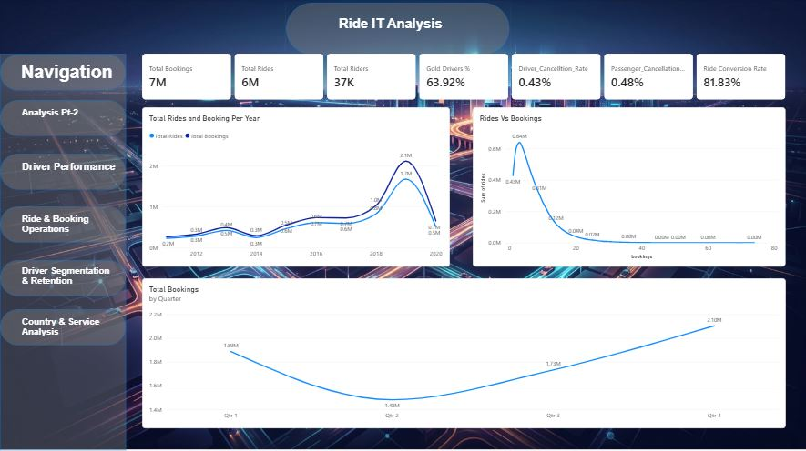
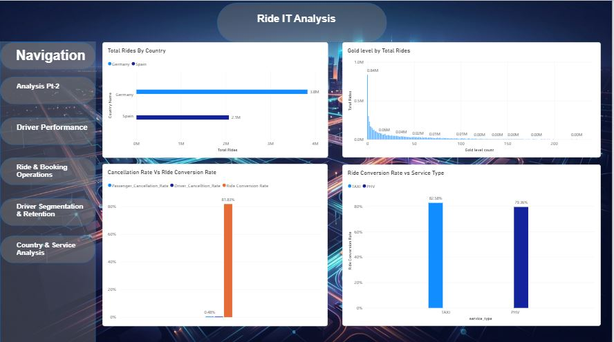
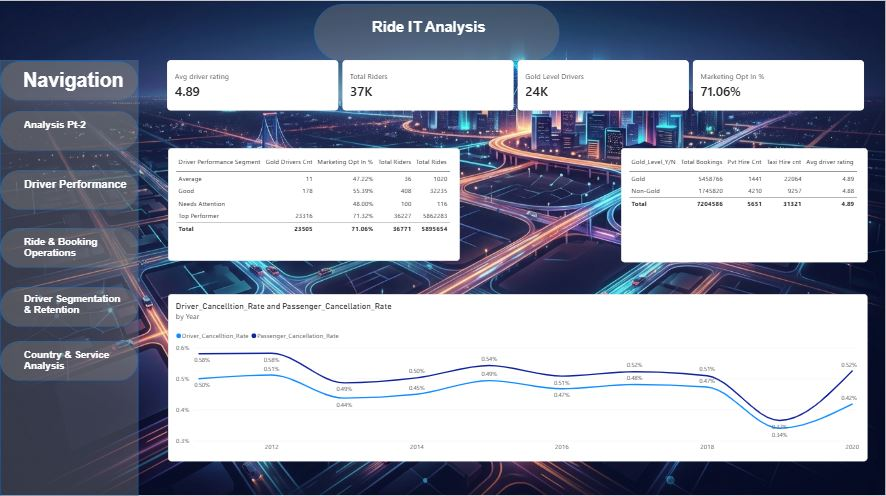
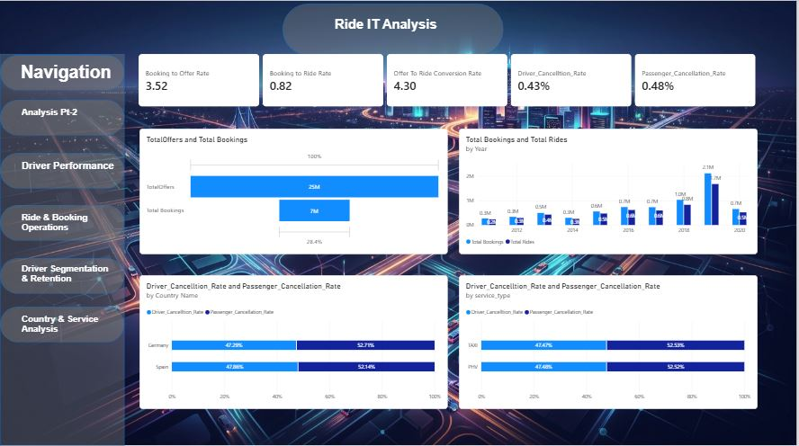
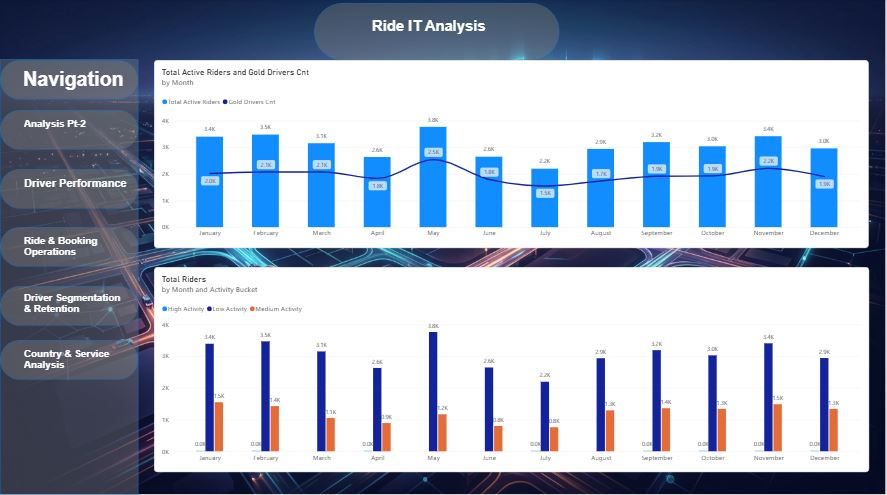
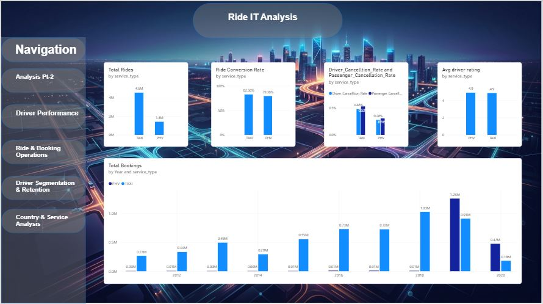

# Ride-IT-Analytics-PowerBI
An interactive Power BI dashboard analyzing ride-hailing operations, driver performance, rider segmentation, and service metrics.
# 🚗 Ride IT Analytics Dashboard

An end-to-end business intelligence project built using **Power BI** to analyze ride-hailing operations, driver performance, rider retention, and regional performance trends (Germany & Spain).

---

## 📊 Project Overview
The **Ride IT Analysis** dashboard provides comprehensive insights into booking conversions, cancellation behaviors, service types (TAXI vs. PHV), and driver segmentation. It helps stakeholders track core operational metrics to improve efficiency and customer retention.

---

## 🚀 Key Performance Indicators (KPIs)
* **Total Bookings:** 7M+
* **Total Rides:** 6M+
* **Total Riders:** 37K
* **Ride Conversion Rate:** 81.83%
* **Driver Cancellation Rate:** 0.43%
* **Passenger Cancellation Rate:** 0.48%
* **Average Driver Rating:** 4.89 / 5.0

---

## 📑 Dashboard Pages & Preview

### 1. Home / Executive Overview
* High-level summary of total bookings, rides, riders, and yearly trends.

### 2. Analysis Part 2 (Country & Conversions)
* Breakdown of total rides by country (Germany vs. Spain) and performance by service type.

### 3. Driver Performance
* Evaluation of driver segments (Top Performers, Good, Needs Attention) alongside ratings and marketing opt-in stats.

### 4. Rides & Bookings Operations
* Analysis of offer-to-ride conversion rates, booking success rates, and cancellation analytics by country and service type.

### 5. Driver Segmentation & Retention
* Monthly active riders, gold driver counts, and rider activity buckets (High, Medium, Low activity).

### 6. Country & Service Analysis
* Comparative metrics between TAXI and PHV service types across multiple operational years.

---

## 🛠️ Tools & Technologies Used
* **Power BI Desktop:** Data modeling, DAX measures, interactive visualizations, and custom navigation layout.
* **GitHub:** Version control and project portfolio presentation.

---

## 👤 Author
Harsha Vardhan Kolagani
